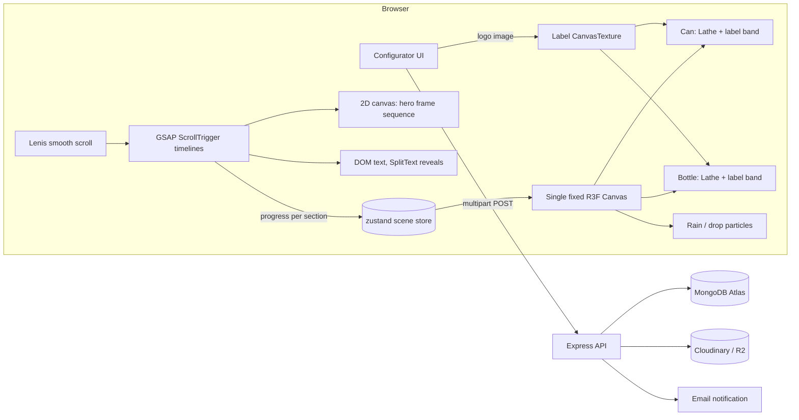

# LANGLOK — Website Master Plan

**Client:** Langlok Int. Company Ltd. (Panchagarh, Bangladesh) · **Brand:** LANGLOK natural drinking water
**Products:** LANGLOK Can 500 ml · LANGLOK Aluminium Bottle 990 ml
**Stack:** MERN (MongoDB, Express, React, Node) + React Three Fiber + GSAP + Lenis
**Prepared:** 16 October 2026 · **Updated:** 17 October 2026 (brand renamed to LANGLOK; Morpho reference, §2.5)

> **Brand name.** The site brand is **LANGLOK** (decided 17 Oct 2026; it was "VERSA" in the first draft of this plan). The client's label artwork still prints the earlier **VERSA** wordmark, so the 3D labels (built from those photos) show VERSA until LANGLOK label files arrive. See §1.3. Current progress lives in [`STATUS.md`](STATUS.md).

---

## 0. TL;DR

- **Creative direction — "Monsoon Light."** A bright, misty, editorial site built on aluminium silver, mist white, navy ink and rain blue. It is the opposite of the usual black-background 3D site. The Chatak (pied cuckoo) that drinks only rain is the thread through the whole experience.
- **Opening = the can itself (Morpho reference, §2.5).** The first screen is the live 3D can, large and centred between the headline and a serif aside. Scrolling tips its lid towards the camera, the tab clicks open, and the camera dives through the opening into the film.
- **Hero = scroll-scrubbed film.** Nature → rain → earth → filtration → canning → one can rising out of mist. Generate it with an AI video tool, edit it into one continuous shot, export it as an **image sequence** (WebP frames) and draw those frames to a `<canvas>` as the user scrolls (GSAP ScrollTrigger). The film begins where the dive ends: pale monsoon sky seen through the can's opening. (The fogged-glass idea moves to the start of the film, or is dropped; decide in Phase 2.)
- **Products = real-time 3D, not video.** The can and bottle are built in code with `LatheGeometry` (both are surfaces of revolution), so the label is a texture we fully control. That makes the "spin → **YOUR LOGO HERE**" reveal and a live **upload-your-logo configurator** easy and lightweight.
- **The handoff.** The film's last frame shows a plain can in the exact pose of the 3D can, then crossfades to the live 3D model. AI video never has to render the logo (AI garbles text); the real label only ever appears in 3D.
- **Backend.** Express + MongoDB handles custom-branding inquiries with logo uploads, ReCan partner sign-ups, newsletter and a simple admin list.

### Your question: "Do I make the video, or do you?"

I can't generate photoreal video footage. The split that works best:

| Who | What |
|---|---|
| **You** | Generate the shots with an AI video tool (prompts are ready in `PROMPTS_for_Claude_Code.md`), join and colour-grade them, export one master file, then run the provided `ffmpeg` commands to cut it into frames. |
| **Claude Code (in VS Code)** | Everything else: the whole front end, the frame-sequence player, the 3D can and bottle, the logo-swap and configurator, animations, the backend, and a **placeholder frame generator** so the hero works from day one before your real footage exists. |

You never block the build: code against placeholder frames, then drop the real frames into `client/public/frames/hero/` and nothing else changes.

---

## 1. Brand audit — what's in the assets

### 1.1 What we have

| Asset | Notes for the build |
|---|---|
| **Can front (500 ml)** | Brushed aluminium with condensation droplets. Illustrated pied cuckoo head, beak open, catching a single water drop. Wordmark **VERSA** (the earlier brand name; the site brand is now LANGLOK) in a classical serif with a crossbar-less "Λ" A. Blue water-wave swash. Lines: *SAY NO PLASTIC / SAVE THE WORLD*, *NATURAL DRINKING WATER*, *pH 7.0*, *500 ML*. |
| **Can back** | Condensed Didone headline (*RECYCLABLE ALTERNATIVE*), tracked caps sans (*CANS ARE AN INFINITELY… / TO PLASTIC BOTTLES*), microplastics paragraph, *This CAN makes a difference.*, `www.langlok.com`, barcode, QR, social icons, *Manufactured in Panchagarh, Bangladesh by Langlok Int. Company Ltd*. |
| **Bottle front / back (990 ml)** | Same art system on a screw-cap aluminium bottle. |
| **Logo/theme image** | Full pied cuckoo perched on an acacia-like branch, forest bokeh, warm golden light. A **different** VERSA wordmark: swash V and A with two navy wave strokes underneath. |
| **Mission.txt** | Premium + sustainable hydration; custom-branded cans and reusable bottles for hotels, food franchises, events and venues; end-to-end service (design → production → delivery → storage → recycling); the closed-loop **ReCan** programme that turns waste cost into revenue. |
| **Story behind the logo.txt** | Chatak waits all summer, refuses ground water, drinks only rain falling from the sky; flies *into* the storm to catch the first drops; the farmer smiles because rain has truly returned. |

### 1.2 Colours pulled from the assets

| Source | Colour | Use |
|---|---|---|
| Can photo backdrop | cool off-white `#F3F5F6` | page background |
| Aluminium highlights | `#C7CDD2` | hairlines, borders, chrome |
| Logo navy | `#16233F` | headlines, primary text |
| Water swash | `#2F7FC1` → `#8FC3EA` | accent, rain, links (darker shade for small text) |
| Acacia leaves | `#6E8B5E` | sparing nature accent |
| Golden bokeh | `#E9B872` | sparing warm highlight (story) |
| "Clouds bruised purple" (story) | `#6C6A86` | story-section sky gradient |

### 1.3 Things to confirm with the client before launch

These matter because they end up in large type on the site.

1. **Bird name.** The story and the artwork are the **Chatak / pied (Jacobin) cuckoo**. In Bengali, *machranga* (মাছরাঙা) means kingfisher, a different bird. The site should say **Chatak (চাতক)** throughout. Please confirm.
2. **Scientific name.** The story writes "Jacobin Clamator". The correct form is ***Clamator jacobinus*** (Jacobin cuckoo).
3. **"The fields of Umm Lajj."** Umm Lajj is a town on Saudi Arabia's Red Sea coast, while the water is made in Panchagarh. If that is not deliberate (e.g., an export market), **Tetulia, Panchagarh** is a much stronger setting: Bangladesh's only flatland tea gardens, Kanchenjunga visible on clear autumn mornings, and the pied cuckoo really does arrive with the South Asian monsoon. This also gives the hero film its location.
4. **Health / purity claims.** The back label says aluminium "leaches nothing" and means "zero microplastics". Aluminium cans and bottles almost always have a thin internal polymer lining (epoxy or BPA-NI coatings). Published tests found BPA migration from some epoxy-lined aluminium bottles and none from others. Recommendation: confirm the lining type with the can supplier, say "BPA-NI lined" if true, and avoid absolute claims on the website ("cleaner", "plastic-free bottle", "infinitely recyclable" are safe; "zero microplastics" may not be). This protects the brand in export markets with advertising rules.
5. **One master logo.** The can uses the Λ wordmark; the forest image uses a swash wordmark with waves. Pick one and supply it as **SVG**.
6. **Volume.** The label says **990 ml**, not 1 litre; the site will use 990 ml.
7. **Flat print files.** We need the unwrapped label artwork (AI / PDF / SVG) for the can and bottle, and the bird illustration as a layered, high-resolution transparent file. Photos of mockups can't be turned into clean 3D labels.
8. **Bottle copy.** The bottle back says "CANS ARE…" and "VERSA can means…". Fine as wordplay, but a bottle-specific line may read better.
9. **Social icons.** Twitter bird → X. Supply real social URLs and the QR code destination.
10. **ReCan details.** How collection works, who pays whom, any real figures (cans collected, revenue shared). We will not invent numbers; counters stay hidden until real data exists.
11. **Site identity.** ✅ Answered 17 Oct 2026: the site brand is **LANGLOK** (not VERSA), domain `langlok.com`.
12. **LANGLOK label artwork.** The can and bottle artwork, and the forest logo image, still print **VERSA**. Is the product being renamed on the pack too? If so we need the LANGLOK label files and logo SVG; until then the 3D labels show the VERSA print (built from the photos) and the header shows a neutral LANGLOK text placeholder.

---

## 2. Creative direction — "Monsoon Light"

### 2.1 The idea in one line

> *Drink only what the sky gives.* The Chatak waits for pure rain; LANGLOK waits for nothing less than pure water, sealed in a vessel that never becomes plastic waste.

Every section answers to that idea: the sky (source), the wait (purity), the vessel (aluminium), the return (ReCan: every can comes home, just as the rain returns).

### 2.2 How it avoids looking like "every other 3D site"

| Common 3D site | LANGLOK |
|---|---|
| Black background, neon gradients | Mist-white, aluminium and rain blue; light as the default, never dark mode first |
| Floating blobs and glassmorphism cards | Editorial magazine grid with 1 px aluminium hairlines and numbered chapters (01 Sky · 02 Earth · 03 Vessel…) |
| One sans-serif everywhere | A Didone display face echoing the can's back label, a geometric sans echoing the can's caps, plus a Bengali accent face |
| Product spins on a void | Product sits in soft studio light with real reflections, condensation droplets and a contact shadow on paper |
| Generic hover effects | Water-native interactions: wipe fog off glass, rain density follows scroll speed, a label that "washes" away to reveal your logo |

### 2.3 Signature interactions (the memorable moments)

1. **Fogged glass hero.** The first screen is covered in white condensation. Moving the cursor (or dragging a finger) wipes a clear trail revealing the monsoon scene; the fog slowly returns. Built with a cheap 2D canvas mask, no WebGL needed.
2. **Sky-to-seal scroll film.** One continuous camera descent, scrubbed by scroll.
3. **The catch.** A single drop falls from the top of the page into the can's opening during the handoff (echoes the label art of the bird catching a drop).
4. **The spin and the swap.** The can spins once with scroll; while its front faces away, the LANGLOK label is swapped for **YOUR LOGO HERE**, so it comes round already changed. v2 upgrade: a "rain-wash" shader where water runs down the can and dissolves one label into the other.
5. **Rain that listens.** In the Chatak story, rain density and streak length follow scroll velocity.
6. **Water-level transitions.** Some section changes fill the viewport from the bottom up, like water rising in a glass (CSS `clip-path`).

### 2.4 Anti-patterns (Claude Code must not do these)

- No black or near-black page backgrounds; no neon; no purple-blue "AI gradient" meshes.
- No glassmorphism cards stacked everywhere; no generic floating 3D blobs.
- No auto-playing sound (an optional rain-ambience toggle, off by default, is fine).
- No text rendered inside WebGL; all copy is real DOM text.
- No AI-generated version of the logo or bird; always use the client's artwork.

### 2.5 Reference: morphowater.com (added 17 Oct 2026)

The client pointed at **MORPHO** (natural spring water in cans, Costa Rica) as the feel to aim for. What it does, and what we take:

| MORPHO does | LANGLOK takes it as |
|---|---|
| The first screen *is* the product: a large, centred, real-time 3D can, headline left ("A world within."), italic serif line right ("Pure possibility.") | **Taken.** Opening screen = the live 3D can, centred; headline left, serif aside right. |
| Two-voice headlines: light geometric sans plus an italic serif accent ("More life. *Less hurry.*") | **Taken.** h1/h2 set in light Jost with the accent in Bodoni Moda italic; copy marks the accent `*like this*`. |
| Scroll tips the can until you look down at the lid ("A small click. A world opens."), the opening shows video, the camera dives through it into full-bleed video chapters | **Taken, as our bridge into the film.** The tab clicks, the opening shows pale sky, the camera dives in and "Sky to Seal" plays. |
| Studio-lit can with crisp highlights and dark reflection bands | **Taken.** Environment with strip lights *and* dark flags, so aluminium reads as metal on a light page. |
| Chapter rail on the left ("01 / 07", vertical label); small "01 —— THE CAN" marker | **Later** (Phase 5 polish). |
| Product line-up with big italic names (Still / Sparkling) | **Taken** in the product panels ("*500 ml*" in large italic). |
| Dark navy page, glass navigation, sound toggle, chat widget | **Not taken.** Light backgrounds stay (Monsoon Light); no autoplay audio. A small *Motion* switch takes the corner instead (§9.3). |

---

## 3. Design system

### 3.1 Colour tokens

```css
:root {
  /* surfaces */
  --mist: #F3F5F6;        /* page background */
  --cloud: #E6EBEE;       /* secondary surface, cards */
  --paper: #FBFCFC;       /* raised surface */
  --aluminium: #C7CDD2;   /* hairlines, borders, chrome */

  /* text */
  --ink: #16233F;         /* headlines, body (logo navy) */
  --slate: #5B6875;       /* secondary text (≈5.2:1 on --mist) */

  /* accents */
  --rain: #2F7FC1;        /* large accents, icons, rain (≈3.9:1, large text only) */
  --rain-deep: #1F64A0;   /* links, small accent text (≈5.7:1 on --mist) */
  --rain-light: #8FC3EA;  /* highlights, droplets */
  --leaf: #6E8B5E;        /* nature accent, sparing */
  --sun: #E9B872;         /* warm highlight, story only */
  --monsoon: #6C6A86;     /* story sky gradient */
}
```

Rules: `--mist` is ~70% of every screen; `--ink` for text; `--rain` used in small doses so it stays special; `--sun` and `--monsoon` appear only in the Chatak story.

### 3.2 Typography (Google Fonts)

| Role | Face | Why |
|---|---|---|
| Display headlines | **Bodoni Moda** (variable, optical sizes) | Echoes the Didone "RECYCLABLE ALTERNATIVE" on the can back; premium, editorial |
| Eyebrows, UI, body | **Jost** | Geometric, Futura-like; matches the tracked caps on the can (*NATURAL DRINKING WATER*) |
| Bengali accent | **Noto Serif Bengali** | For চাতক and a few Bengali words in the story |
| Wordmark | Client's **SVG logo** | Never typeset the logo |

Type scale (fluid, `clamp()`): display 64–160 px, H2 40–88 px, H3 24–40 px, body 17–19 px, eyebrow 12–13 px uppercase with `letter-spacing: 0.24em`.

### 3.3 Layout

- 12-column grid, max width 1440 px, generous margins (`clamp(20px, 5vw, 96px)`).
- 1 px `--aluminium` hairlines separate chapters; chapter numbers in Jost small caps.
- Pinned sections use `svh`/`lvh` units so mobile address bars don't cause jumps.

### 3.4 Motion principles

- **Water, not springs.** Eases are long and liquid: `power2.out`, `expo.out`, `sine.inOut`. No bouncy overshoot.
- **Scroll owns the story; idle owns the life.** Scroll scrubs the big moves; a slow idle drift (product breathing, droplets sliding, fog returning) keeps it alive when the user stops.
- **Text reveals line by line** (GSAP SplitText, mask from below).
- **Durations:** UI 200–350 ms; reveals 700–1100 ms; nothing above 1.4 s unless scrubbed.
- **`prefers-reduced-motion`:** no smooth scroll, no scrubbed film (three crossfading stills instead), no auto-spin, no rain.

---

## 4. Site map and scroll choreography

### 4.1 Pages

| Route | Content |
|---|---|
| `/` | The full scroll experience (sections below) |
| `/custom-branding` | Configurator + inquiry form (also reachable as a section/modal from home) |
| `/recan` | ReCan programme detail + partner sign-up |
| `/story` | Long-form Chatak story (shareable) |
| `/contact` | Contact form, address, map link |
| `/admin` | Protected inquiry list (v1: simple auth) |

### 4.2 Home page timeline

```
SCROLL ▼
┌──────────────────────────────────────────────────────────────────────────┐
│ 00 PRELOADER     drop falls, fills a thin line; first frames + 3D load   │
├──────────────────────────────────────────────────────────────────────────┤
│ 01 HERO (~600vh track)  the can → the dive → scroll film "Sky to Seal"    │
│    INTRO      live 3D can, centred; headline left, serif aside right      │
│    DIVE ~90vh lid tips to camera, tab clicks, opening shows sky, dive in  │
│    A  0–15%   monsoon clouds over Tetulia tea gardens                     │
│    B 15–35%   rain begins; a Chatak silhouette rises into it              │
│    C 35–55%   drops sink through soil and stone (macro, clear)            │
│    D 55–75%   bright stainless filtration hall, water through glass pipes │
│    E 75–90%   aluminium cans on a filling line, sealed                    │
│    F 90–100%  one plain can rises out of mist on a light backdrop         │
├──────────────────────────────────────────────────────────────────────────┤
│ 02 HANDOFF       last frame crossfades to the live 3D can (same pose);    │
│                  one drop falls into the can opening                      │
├──────────────────────────────────────────────────────────────────────────┤
│ 03 PRODUCTS (pinned)  Can 500 ml spins 360° with scroll + spec callouts;  │
│                  camera eases, Bottle 990 ml enters and spins             │
├──────────────────────────────────────────────────────────────────────────┤
│ 04 YOUR LOGO HERE (pinned)  both spin again; label swaps on hidden side;  │
│                  "Your name, on our water."  CTA → configurator            │
├──────────────────────────────────────────────────────────────────────────┤
│ 05 CONFIGURATOR  upload logo, pick vessel, drag to rotate, request quote  │
├──────────────────────────────────────────────────────────────────────────┤
│ 06 CHATAK STORY  5 chapters, rain follows scroll speed, bird catches drop │
├──────────────────────────────────────────────────────────────────────────┤
│ 07 MISSION       editorial statement + horizontal strip of 5 stages       │
├──────────────────────────────────────────────────────────────────────────┤
│ 08 RECAN LOOP    SVG loop draws on scroll; a can travels the loop         │
├──────────────────────────────────────────────────────────────────────────┤
│ 09 WHY ALUMINIUM three careful, sourced facts                             │
├──────────────────────────────────────────────────────────────────────────┤
│ 10 WHO WE SERVE  hotels · food franchises · events · venues               │
├──────────────────────────────────────────────────────────────────────────┤
│ 11 CTA + FOOTER  "Bring LANGLOK to your venue." Langlok, Panchagarh         │
└──────────────────────────────────────────────────────────────────────────┘
```

### 4.3 Section specs

**00 Preloader.** A single drop falls from the top centre and becomes a thin horizontal progress line. Waits for: poster frame, first ~20 hero frames, fonts, and the 3D scene's essentials (lazy-load the rest). Minimum display 600 ms, maximum ~3 s, then reveals regardless.

**01 Hero — the can, the dive, then "Sky to Seal".** *(Intro and dive built 17 Oct 2026; film in Phase 2.)*
- **Intro (first screen).** The live 3D can stands centred on a soft studio light (a fixed backdrop *behind* the canvas), rises in with a turn on first load, breathes (slow sway and float) and turns a little towards the pointer. Headline left: **Drink only what *the sky gives.*** with the sub *Every drop of LANGLOK begins as monsoon rain over the north of Bangladesh.*; aside right: ***A vessel for the rain.*** with *Aluminium can · 500 ml / Aluminium bottle · 990 ml*.
- **Dive (first ~90 vh, the opening screen holds).** The intro copy lifts away; the can tips its lid towards the camera and grows while the lid comes to the centre; the tab lifts with a click and the opening appears showing pale sky; caption **One small click. *The sky opens.*** The camera ends inside the opening and the sky stage (the film) fades up over it.
- **Film.** Layer stack (bottom → top): frame canvas → optional WebGL rain overlay (beats A–B only) → DOM text beats → scroll hint. ~500 vh of scroll, `scrub: 0.5`. Its first frame should match the dive's end: pale monsoon sky seen through a round opening.
- Copy beats (original lines; client can edit in `content/copy.ts`):
  - A: **Drink only what the sky gives.** (now the intro headline)
  - B: **The rain *returns.*** *Like the Chatak, we wait for it.*
  - C: **Filtered by *earth and time.***
  - D: **Purified *with care.*** *Natural drinking water, pH 7.0.*
  - E: **Sealed in aluminium. *Never plastic.***
  - F: **Meet LANGLOK.**
- Mouse parallax: the frame canvas scales 1.04 and shifts ±12 px with pointer (desktop only).
- Reduced motion: no hold and no dive; the opening screen scrolls away and the sky crossfades in.

**02 Handoff.** *(Built: beat F's plate is where the 3D can comes back; the sky stage fades to the mist page and the can stands there, then glides to the products.)* At hero progress 0.97–1.0 the frame canvas fades out while the WebGL can fades in at the identical position, scale and angle. The can in the final frame is plain (no readable label) and seen slightly from the side, so any small mismatch reads as natural. A drop falls into the opening; a tiny ripple ring on contact.

**03 Products.** *(Built in Phase 3: each vessel stands ~70% of the viewport tall, name in light sans, volume in large italic serif; phones and reduced motion turn the vessel as the panel passes instead of pinning.)*
- Can: pinned; rotation Y 0 → 2π over the pin; callouts slide in from the hairline grid: *500 ml*, *Natural drinking water*, *pH 7.0*, *Infinitely recyclable aluminium*.
- Bottle: camera dollies right, can steps to the left third, bottle rises in and spins; callouts: *990 ml*, *Resealable aluminium bottle*, *Refill, reuse, repeat*.
- Idle: a slow ±6° sway and droplets sliding on the label (normal-map offset animation).

**04 Your Logo Here.** Both vessels side by side. Scroll drives one more full spin. When rotation passes π (front facing away), the label texture switches to the "YOUR LOGO HERE" variant; scrolling back switches it back at the same point, so it's deterministic in both directions. Headline: **Your name, on our water.** Sub: *Custom-branded cans and bottles for hotels, franchises, events and venues.* CTA: **Try it with your logo →**.

**05 Configurator.** Not scroll-driven; fully interactive.
- Upload PNG/SVG/JPG (≤5 MB), or type a brand name to set it in a chosen font.
- Choose vessel (can / bottle / both), label background (silver / white / navy / custom hex), logo size and vertical position.
- Drag to rotate (drei `PresentationControls`, limited polar angle), double-click to reset.
- "Save preview" captures a PNG of the 3D view; "Request a quote" opens the inquiry form with the preview and logo attached.

**06 Chatak story.** Five pinned chapters following the client's text, with the background moving from pale dry-season sky to bruised monsoon violet and back to washed-clean light:
1. *He waited* — dry acacia branch, the bird still (client's illustration, cut-out layers).
2. *Others drank from the pond* — small sparrow silhouettes dip to puddles; Chatak does not.
3. *They thought he was proud. He was just faithful.* — the key line, full-screen.
4. *The monsoon wind turned* — clouds roll in, rain particles start, density follows scroll speed.
5. *He flew into the storm* — the bird lifts, a single drop falls into the open beak (the label image, now alive); final line about the farmer.
Title treatment: **চাতক** in Noto Serif Bengali beside *Chatak* in Bodoni Moda.

**07 Mission.** Large editorial statement (Bodoni, 2–3 lines): **Premium shouldn't cost the planet.** Then the mission paragraph, then a horizontal-scroll strip: **Design → Production → Delivery → Storage → Recycling**, each a card with a line icon and one sentence. Ends with *You focus on your guests. We handle the rest.*

**08 ReCan loop.** A circular SVG path draws itself on scroll (DrawSVG); a can icon travels it (MotionPath): **Serve → Collect → Recycle → Reborn**. Headline: **Every can comes home.** Sub: how waste-management cost becomes a revenue stream. Partner CTA → `/recan`. Counters only when real data exists.

**09 Why aluminium.** Three cards with careful, verifiable claims (e.g., recyclability rates, weight, plastic-free bottle body). Each card has a footnote source. Avoid absolute health claims until the lining is confirmed (see 1.3.4).

**10 Who we serve.** Four tall cards (hotels, food franchises, events, venues) with photography, subtle 3D tilt on hover, and a mocked-up branded can per category (rendered from the same 3D scene with placeholder logos).

**11 CTA + footer.** **Bring LANGLOK to your venue.** Primary: *Request samples*; secondary: *Talk to us*. Footer: logo, short mission line, links, social, *Manufactured in Panchagarh, Bangladesh by Langlok Int. Company Ltd.*

---

## 5. Tech stack and architecture

### 5.1 Stack (pin exact versions with `npm i` at project start)

| Layer | Choice | Notes |
|---|---|---|
| Build | **Vite** + **React 19** + **TypeScript** | Fast dev server, simple SPA |
| 3D | **three**, **@react-three/fiber v9**, **@react-three/drei v10** | R3F v9.5 supports React 19.0–19.2 |
| Animation | **GSAP 3** + **ScrollTrigger**, **SplitText**, **DrawSVG**, **MotionPath**, `@gsap/react` (`useGSAP`) | All GSAP plugins are free, including commercial use |
| Smooth scroll | **Lenis** (`lenis/react`), synced to the GSAP ticker | Touch stays native by default |
| State | **zustand** | Transient scroll state read inside `useFrame`, no React re-renders |
| Damping | **maath** (`easing.damp`) | Smooth 3D motion from scroll targets |
| Styling | **Tailwind CSS v4** (tokens in CSS) or CSS Modules | Pick one; tokens live in `styles/tokens.css` either way |
| Routing / meta | React Router, `react-helmet-async` | |
| Forms | react-hook-form + zod | Same zod schemas reused on the server |
| Backend | **Node.js LTS**, **Express 5**, **Mongoose**, zod, multer, sharp, helmet, cors, express-rate-limit | |
| Data / files | MongoDB Atlas; Cloudinary or Cloudflare R2 for uploads | |
| Email | Resend or Nodemailer (SMTP) | Inquiry notifications |
| Hosting | Client: Vercel / Netlify / Cloudflare Pages · API: Render / Railway / Fly.io | Frames and textures served with long cache headers |

**SEO note:** a Vite SPA is weaker for search. Prerender the marketing routes at build time, or move the client to Next.js if organic search is a priority; the R3F/GSAP work is identical either way (client components).

### 5.2 Architecture



Key rules:

1. **One WebGL canvas for the whole page.** A fixed, full-viewport R3F `<Canvas>` sits behind the DOM. Sections in the DOM are spacers and text; the 3D scene reads which section is active from the store and shows, moves or hides objects. Never mount a second WebGL canvas.
2. **ScrollTrigger writes, `useFrame` reads.** ScrollTrigger `onUpdate` writes progress numbers into the store (transient, no `setState` re-renders). Components read them in `useFrame` and `easing.damp` towards the target.
3. **Pause rendering when 3D is off-screen.** Switch the canvas `frameloop` to `"never"`/`"demand"` while the hero film or long text sections own the screen.
4. **The hero film is a separate 2D canvas** (cheap) layered under the WebGL canvas, which is transparent during the handoff.
5. **All copy lives in `client/src/content/copy.ts`** so the client's edits never touch components.

### 5.3 Folder structure

```
langlok/
├─ CLAUDE.md                     # project brief Claude Code loads every session
├─ docs/
│  ├─ LANGLOK_Website_Master_Plan.md
│  └─ PROMPTS_for_Claude_Code.md
├─ client/
│  ├─ public/
│  │  ├─ frames/hero/desktop/0001.webp …   # 16:9 sequence
│  │  ├─ frames/hero/mobile/0001.webp …    # 9:16 sequence
│  │  ├─ textures/  label-can.webp, label-can-orm.webp (+ -1024),
│  │  │             label-bottle.webp, label-bottle-orm.webp (+ -1024),
│  │  │             droplets-normal.webp, brushed-alu-roughness.webp
│  │  ├─ hdri/studio-soft.hdr (or use drei Lightformers only)
│  │  └─ img/  stills/ (studio stills of the 3D vessels), bird-layers/, og-image.jpg
│  └─ src/
│     ├─ app/          App.tsx, routes.tsx, providers (Lenis, Helmet)
│     ├─ sections/     Preloader, Hero, Handoff, Products, YourLogo,
│     │                Configurator, ChatakStory, Mission, ReCanLoop,
│     │                WhyAluminium, WhoWeServe, CtaFooter
│     ├─ three/        Scene.tsx, Lighting.tsx, Can.tsx, Bottle.tsx,
│     │                profiles.ts, labelTexture.ts, materials.ts,
│     │                Rain.tsx, Drop.tsx
│     ├─ components/   ui/ (Button, Eyebrow, Hairline, ChapterNumber…), FogGlass.tsx
│     ├─ hooks/        useImageSequence, useSectionProgress, useDeviceTier,
│     │                useReducedMotion
│     ├─ store/        scene.ts (zustand)
│     ├─ lib/          gsap.ts (register plugins once), lenis.ts, api.ts
│     ├─ content/      copy.ts
│     └─ styles/       tokens.css, globals.css, fonts.css
├─ server/
│  └─ src/  index.ts, routes/ (inquiries, newsletter, recan, admin, stats),
│           models/ (Inquiry, Subscriber, Stat), middleware/ (upload, rateLimit,
│           auth, validate), lib/ (mailer, storage)
└─ scripts/
   ├─ make-placeholder-frames.sh
   ├─ extract-frames.sh
   └─ optimize-textures.sh
```

---

## 6. Hero — the scroll-scrubbed film

### 6.1 Why an image sequence (not a `<video>`)

| Approach | Pros | Cons | Verdict |
|---|---|---|---|
| **Image sequence on `<canvas>`** (Apple AirPods-style) | Frame-perfect scrubbing forwards and backwards on every browser; easy progressive loading | Many files; must manage weight | **Use this** |
| `<video>` + set `currentTime` on scroll | One file | Seeking is janky, especially on iOS Safari, unless every frame is a keyframe (which makes the file large anyway) | Fallback only |
| Real-time 3D for the whole hero | Fully interactive | Huge effort to look photoreal (landscape, water, factory) | Not for v1 |

GSAP publishes a ready "image sequence scrub" helper that draws the nearest frame to a canvas as a ScrollTrigger scrubs; Claude Code should start from that pattern and add progressive loading.

### 6.2 Storyboard (one continuous descent, no hard cuts)

The camera always moves **forward and down**, slowly and steadily. Steady motion scrubs smoothly; fast motion, flicker and cuts look broken when scrubbed backwards.

| Shot | Length | What we see | Ends on (= next shot's first frame) |
|---|---|---|---|
| 1 Sky | 4–5 s | Dawn over flat tea gardens of Tetulia; faint snowy Himalayan peaks on the horizon; monsoon clouds gathering. Light, pale, misty. | Clouds fill the frame |
| 2 Rain | 4–5 s | Inside the cloud, rain begins; camera falls with the drops; a pied cuckoo silhouette rises past the lens into the rain | A single drop in close-up, falling |
| 3 Earth | 4–5 s | The drop lands on leaves, sinks into soil; cross-section macro of water filtering through sand, gravel and stone, clear and bright | Clear water flowing in an underground channel |
| 4 Purify | 4–5 s | The channel becomes a stainless steel pipe; bright white filtration hall, glass pipes, soft daylight, clean | Water stream entering a filling nozzle |
| 5 Seal | 4–5 s | Silver cans (no readable text) on a filling line; one is filled and sealed; droplets of condensation | One can lifted out of the line |
| 6 Reveal | 3–4 s | The single can rises out of soft white mist onto a pale backdrop, slightly turned, label side away | Locked final pose = 3D handoff pose |

Total ~25 s. For ~500 vh of scroll, **150–180 frames on desktop** and **90–110 on mobile** is plenty (scrolling interpolates perceptually).

### 6.3 Generating the footage

As of October 2026 the strongest options are **Google Veo 3.1** (via Flow / Gemini; best overall realism), **Kling 3.0** (best value, native 4K, handles liquids well) and **Runway Gen-4.5** (best camera and keyframe control). **OpenAI's Sora is no longer an option**: the app closed in April 2026 and the API shut down on 24 September 2026.

Workflow that keeps the shots continuous:

1. **Make 7 key stills first** with an image model (the 6 shot starts + the final pose), all with the same style prompt so lighting and palette match.
2. **Animate between stills** using image-to-video with **first-frame / last-frame** control: shot N uses still N as its first frame and still N+1 as its last frame. This makes the joins seamless.
3. **Never show readable text or the logo** in AI footage; AI mangles lettering. The real label appears only in 3D after the handoff.
4. **Compose for both crops**: keep the subject inside the centre 9:16 safe area so the same footage can be cropped to portrait for mobile. If the tool allows, also generate native 9:16 versions of the key shots.
5. **Use a paid plan** for commercial rights; free tiers usually exclude commercial use.

Shot-by-shot prompts and a negative prompt are in `PROMPTS_for_Claude_Code.md` → *Part C*.

### 6.4 Editing

DaVinci Resolve (free) or CapCut:
1. Join the six clips; trim any morphing frames at the joins; add 6–10 frame cross-dissolves only if a join still jumps.
2. **Stabilize** (scrubbing exaggerates jitter).
3. **Grade to Monsoon Light:** lift shadows (no crushed blacks), cool highlights slightly, keep whites soft. The film must sit on a `--mist` page without looking like a dark box.
4. Remove audio. Export a high-quality master: **ProRes 422** or **H.264 at ≥40 Mbps**, 1920×1080 (or 4K), 24 or 30 fps.
5. Make the **last frame** match the 3D camera: render the 3D can in the same pose (Claude Code can add a debug screenshot button), overlay it in the editor at 50% opacity, and nudge the final shot's position and scale.

### 6.5 Cutting frames with ffmpeg

Pick the frame count, then `fps = targetFrames ÷ videoSeconds` (e.g., 160 frames ÷ 25 s = 6.4).

```bash
# Desktop 16:9 → 1600 px wide WebP (≈50–90 KB/frame)
mkdir -p client/public/frames/hero/desktop
ffmpeg -i hero_master.mov \
  -vf "fps=6.4,scale=1600:-2:flags=lanczos" \
  -c:v libwebp -quality 70 -compression_level 6 \
  client/public/frames/hero/desktop/%04d.webp

# Mobile 9:16 → crop the centre, 720 px wide
mkdir -p client/public/frames/hero/mobile
ffmpeg -i hero_master.mov \
  -vf "fps=4,crop=ih*9/16:ih,scale=720:-2:flags=lanczos" \
  -c:v libwebp -quality 65 -compression_level 6 \
  client/public/frames/hero/mobile/%04d.webp

# Poster (first frame) as a high-priority LCP image
ffmpeg -i hero_master.mov -frames:v 1 -vf "scale=1600:-2" -q:v 3 client/public/frames/hero/poster.jpg
```

Weight budget: desktop ≤ 12 MB total, mobile ≤ 5 MB total, loaded progressively (below).

### 6.6 Placeholder frames (so coding starts today)

```bash
# 160 numbered placeholder frames in the brand colours
mkdir -p client/public/frames/hero/desktop
ffmpeg -f lavfi -i "color=c=0xE6EBEE:s=1600x900:r=8:d=20" \
  -vf "drawtext=text='%{frame_num}':fontsize=220:fontcolor=0x16233F:x=(w-tw)/2:y=(h-th)/2" \
  -frames:v 160 -c:v libwebp -quality 60 \
  client/public/frames/hero/desktop/%04d.webp
# If ffmpeg reports a font error, add  fontfile=/path/to/any.ttf:  inside drawtext.
```

### 6.7 Player implementation notes (for Claude Code)

- **Progressive loading:** load the poster, then every 8th frame, then every 4th, 2nd, then the rest. When drawing, use the **nearest loaded frame** to the target index. The film is scrubbable within ~1 s on 4G.
- Decode with `img.decode()` (or `createImageBitmap`) before drawing; never draw an undecoded image.
- Draw with "cover" math so the canvas fills the viewport at any aspect; set canvas size from `devicePixelRatio`, capped at 2.
- Pick `desktop` vs `mobile` set by viewport aspect (portrait → mobile) at load, not on every resize.
- `scrub: 0.5`, `pin: true`, `anticipatePin: 1`; `ScrollTrigger.config({ ignoreMobileResize: true })`.
- Text beats are separate ScrollTrigger tweens on the same timeline (positions as fractions of the pin).
- Fog glass: offscreen 2D canvas filled with a white fog texture; pointer moves draw soft circles with `globalCompositeOperation = 'destination-out'`; every frame repaint fog at low alpha so it slowly returns. Disable after the user scrolls 10% (fade out).

---

## 7. 3D products — can and bottle

### 7.1 How to get the models

| Option | Effort | Label control | Weight | Verdict |
|---|---|---|---|---|
| **A. Procedural in code** (`LatheGeometry` profile + separate label band) | Low | Perfect (we own the UVs) | ~0 KB | **v1 — use this** |
| B. Model in Blender, export glTF (Draco/meshopt) | Medium | Good if UVs are laid out for the label | 100–500 KB | v2, for pull-tab and screw-thread realism |
| C. AI image-to-3D (Meshy 6, Tripo v3.1, Rodin Gen-2.5, Hunyuan 3D) | Very low | Poor: label baked into texture, messy UVs | 2–20 MB | Not for products; fine for background props |

Both vessels are surfaces of revolution: a 2D outline rotated around the vertical axis. `LatheGeometry` does exactly that, and it is the approach three.js developers commonly recommend for cans. The only external input needed is the **supplier's dimension drawing**.

### 7.2 Geometry recipe

- Units: **1 unit = 1 cm** (real scale makes lighting and camera intuitive).
- Typical 500 ml can is about **6.6 cm Ø × 16.8 cm**; confirm with the supplier (the photo looks slimmer). The 990 ml bottle has no standard size: use the spec sheet.
- *(As built, Phase 3: profiles traced from the photos live in `three/vesselSpec.json`; the label is mapped on the lathe body itself, v by height and clamped to bare silver, because the print runs onto the neck taper where a straight band can't follow. Each vessel also has a `frame`, the box it stands in on the page.)*
- Build each vessel from three meshes:
  1. **Body** — `LatheGeometry(profilePoints, 128)`, brushed aluminium material.
  2. **Label band** — open `CylinderGeometry(r × 1.002, r × 1.002, labelHeight, 128, 1, true)` over the straight section, transparent label material. Set `thetaStart: Math.PI` so the centre of the label canvas faces the camera and the seam sits at the back.
  3. **Top** — can: lid + simple pull-tab (a few boxes/torus is enough); bottle: cap as a lathe with a ribbed normal map.

```ts
// three/profiles.ts — starting point; tune against the supplier drawing.
// Uses lines + quadratic curves (not a spline): Catmull-Rom splines overshoot,
// which would push the body outside the label band. Tested: max radius = r exactly.
import { Path } from 'three';

export function canProfile({ r = 3.3, h = 16.8, neckR = 2.75 } = {}) {
  const p = new Path();
  p.moveTo(0, 0.35);                                  // recessed bottom dome centre
  p.quadraticCurveTo(r * 0.35, 0.3, r * 0.6, 0);      // dome → stand ring
  p.quadraticCurveTo(r * 0.97, 0.05, r, 1.0);         // bottom shoulder
  p.lineTo(r, h - 1.7);                               // straight body = label zone
  p.quadraticCurveTo(r, h - 0.9, neckR + 0.2, h - 0.45); // top shoulder
  p.lineTo(neckR, h - 0.1);                           // neck
  p.lineTo(neckR + 0.08, h);                          // rim
  p.lineTo(neckR - 0.15, h - 0.05);
  p.lineTo(0, h - 0.35);                              // recessed lid
  return p.getPoints(24);                             // → new LatheGeometry(points, 128)
}
```

### 7.3 Materials and lighting (what makes cans look premium)

- **Aluminium:** `MeshPhysicalMaterial` — `metalness: 1`, `roughness: 0.28–0.35`, a subtle **brushed roughness map** (horizontal streaks), `clearcoat: 0.3`.
- **Label ink:** `MeshPhysicalMaterial` — `metalness: 0.15`, `roughness: 0.45`, `transparent: true`, map = label texture (ink on transparent so silver shows through, like real printed aluminium).
- **Condensation:** a tiling **droplets normal map** on both body and label (CC0 sources: ambientCG, Poly Haven), slowly offset downward on idle so drops seem to slide.
- **Lighting:** drei `<Environment>` built from `<Lightformer>`s (two tall soft strips + one top light) rather than a busy HDRI; this gives the clean vertical highlight streaks seen on premium can renders. Add `<ContactShadows>` on a paper-coloured floor.
- *(As built: plus a back light for the rims and two **dark flags** at the sides. A cylinder's column at angle φ reflects the direction at 2φ, so flags at 90° print dark bands at 45° between the highlights and the rims; that contrast is what makes aluminium read as metal on a light page. The contact shadow is a soft texture behind the base.)*
- **Colour management:** sRGB textures, ACES or AgX tone mapping; check that `--mist` behind the canvas and the canvas background match exactly (transparent canvas recommended).

### 7.4 Label textures

- Ask the designer for flat label art at the **exact wrap ratio**: width = circumference (2πr), height = label height. For r = 3.3 cm and a 14 cm band, that is ~20.7 × 14 cm (ratio ≈ 1.48).
- Export **4096 px wide** (desktop) and **2048 px** (mobile) PNGs with transparency, then compress to **KTX2** for production (`gltf-transform` / `toktx`).
- Four textures: brand + YOUR LOGO HERE for each vessel. The "your logo" version keeps the whole layout but replaces the bird + wordmark zone with a tasteful dashed placeholder and the words **YOUR LOGO HERE**.
- *(As built: until flat files arrive, `scripts/build-label-textures.py` builds the colour + ORM maps (`label-{can,bottle}[-orm][-1024].webp`) from the mockup photos, and `labels.ts` composes the YOUR LOGO HERE variant at runtime. The photos print the old VERSA wordmark.)*
- Front art is centred at u = 0.5 of the canvas; the back copy sits around u = 0 / 1 (the seam).

### 7.5 Scroll spin and the logo swap

```ts
// inside useFrame — progress p (0..1) comes from the store, written by ScrollTrigger
const targetAngle = p * Math.PI * 2;              // one full turn over the pin
easing.damp(group.current.rotation, 'y', targetAngle, 0.25, delta);

// swap exactly when the front faces away (angle ≈ π) — deterministic both ways
const showCustom = p > 0.5;                       // 0.5 of this pin ⇔ angle π
if (labelMat.map !== (showCustom ? texCustom : texVersa)) {
  labelMat.map = showCustom ? texCustom : texVersa;
  labelMat.needsUpdate = true;
}
```

Pre-create both textures once and swap the reference; never re-upload textures every frame.

**v2 "rain-wash" swap:** a small `onBeforeCompile` (or custom shader material) that mixes the two label textures with a threshold driven by `progress`, a vertical gradient and a noise texture with drip-shaped streaks, so the LANGLOK print appears to wash downward and reveal the new logo.

### 7.6 Live logo configurator

1. User uploads a file → validated client-side (type, ≤5 MB). SVGs are sanitized (DOMPurify) before drawing.
2. An offscreen 2D canvas draws the "your logo" label template, then the uploaded logo into the logo zone (fit-contain, user-adjustable scale and Y offset), plus the chosen background colour.
3. That canvas is a `CanvasTexture`; set `texture.needsUpdate = true` after each redraw (debounced). Same canvas feeds can and bottle.
4. "Save preview": render one frame and read `gl.domElement.toDataURL('image/png')` (needs `preserveDrawingBuffer` only while capturing, or render to a target).
5. "Request a quote" sends the form + original logo + preview PNG to `POST /api/inquiries`.

### 7.7 Performance rules for the 3D scene

- `dpr={[1, 1.75]}`; drei `<PerformanceMonitor>` lowers DPR and disables extras on weak devices.
- No real-time shadows (contact shadows only); no heavy postprocessing (optional SMAA on desktop).
- 128 radial segments desktop, 64 mobile.
- Lazy-load the R3F chunk after the hero's first frames are visible.
- Pause the render loop when no 3D section is on screen.

---

## 8. Backend (MERN API)

### 8.1 Endpoints

| Method | Path | Purpose |
|---|---|---|
| POST | `/api/inquiries` | Custom-branding / sample request; `multipart/form-data` with optional `logo` and `preview` files |
| POST | `/api/recan/partners` | ReCan partner sign-up (stored as an inquiry with `type: 'recan'`) |
| POST | `/api/newsletter` | Email subscription (double opt-in email) |
| GET | `/api/stats` | Public counters set by admin (hidden on the site until non-zero) |
| GET | `/api/admin/inquiries` | Protected list, filter by status/type, paginated |
| PATCH | `/api/admin/inquiries/:id` | Update status / notes |
| GET | `/api/health` | Health check |

### 8.2 Inquiry model

```ts
{
  type: 'branding' | 'samples' | 'recan' | 'contact',
  name, company, email, phone?, country,
  businessType: 'hotel' | 'franchise' | 'event' | 'venue' | 'other',
  product: 'can500' | 'bottle990' | 'both',
  quantityEstimate?: string,          // e.g. "5,000–20,000 / month"
  message?: string,
  logoUrl?: string, previewUrl?: string,
  consent: boolean,
  status: 'new' | 'contacted' | 'quoted' | 'won' | 'lost',
  notes?: string,
  utm?: { source, medium, campaign },
  createdAt, updatedAt
}
```

### 8.3 Security and reliability

- `helmet`, CORS allowlist (site domains only), `express-rate-limit` on all POST routes, request size limits.
- File uploads via `multer` memory storage → check real file type by magic bytes → **SVGs rasterized to PNG with `sharp`** (never serve user SVG directly) → upload to Cloudinary/R2 → store URL.
- zod schemas shared with the client form.
- Spam: honeypot field + Cloudflare Turnstile.
- Admin: v1 single admin with hashed password + JWT in httpOnly cookie; v2 proper users.
- Notification email to the sales inbox and an auto-reply to the customer.
- Environment variables: `MONGODB_URI`, `CLIENT_ORIGIN`, `CLOUDINARY_*` or `R2_*`, `RESEND_API_KEY` or `SMTP_*`, `TURNSTILE_SECRET`, `ADMIN_EMAIL`, `ADMIN_PASSWORD_HASH`, `JWT_SECRET`.

---

## 9. Performance, accessibility, SEO, fallbacks

### 9.1 Budgets

| Metric | Target |
|---|---|
| LCP (poster image) | < 2.5 s on 4G |
| Initial JS (gz), excluding the lazy 3D chunk | < 200 KB |
| Hero frames | desktop ≤ 12 MB, mobile ≤ 5 MB, progressive |
| 3D frame rate | 60 fps desktop, ≥ 40 fps mid-range Android |
| CLS | < 0.05 |

### 9.2 Device tiers (`useDeviceTier`)

- **High:** full experience.
- **Medium:** DPR 1.25, 64 segments, no rain overlay in the hero.
- **Low / no WebGL:** every vessel plate shows a **studio still** rendered from the same 3D scene (`/dev/studio`, `public/img/stills/`), so the whole can and bottle always show, never a cropped photo; configurator shows a 2D flat label preview.

### 9.3 Accessibility

- All text in the DOM; canvases `aria-hidden="true"` with a text alternative nearby.
- `prefers-reduced-motion`: Lenis off, film replaced with 3 crossfading stills, no auto-spin, no rain, instant reveals. The live 3D vessels still show (no pins, glides, drift or dive; they turn in place as their section passes), so nobody gets a cropped photo instead of the product.
- **Motion switch** (bottom corner, *Motion On/Off*): starts from the OS setting and lets visitors choose either way, remembered per browser (`lib/motion.ts`). Many Windows PCs report reduced motion because *Settings → Accessibility → Visual effects → Animation effects* is off; the switch lets those visitors opt in.
- Visible focus states; configurator fully keyboard-operable (arrow keys rotate, +/- scale logo).
- Contrast: body text uses `--ink`/`--slate`; `--rain` only for large text/graphics; links use `--rain-deep`.
- Skip link to main content; story section readable as plain text.

### 9.4 SEO

- Prerendered HTML for `/`, `/story`, `/recan`, `/custom-branding`, `/contact` (or Next.js).
- Titles/meta per route, Open Graph image (can render on mist), `Organization` and `Product` JSON-LD, sitemap.xml, robots.txt.
- Real, crawlable copy in every section (the story is great SEO content).

---

## 10. Build phases

Rough effort for one developer working with Claude Code. Live progress: [`STATUS.md`](STATUS.md).

| Phase | Deliverable | Effort | Done when | Status (17 Oct 2026) |
|---|---|---|---|---|
| **0 Setup** | Monorepo, Vite + React + TS, deps, tokens, fonts, GSAP + Lenis wiring, `CLAUDE.md` | 0.5–1 day | Dev server runs; a test ScrollTrigger pins with Lenis | ✅ Done |
| **1 Skeleton** | All sections as static, responsive layouts with real copy from `copy.ts` | 2 days | Whole page readable on mobile and desktop without any animation | ✅ Done |
| **2 Hero** | Preloader, frame player on placeholders, text beats, fog glass | 2 days | Scrubs smoothly both directions; LCP poster in place | ⏭ Next: film behind the dive |
| **3 3D products** | Procedural can + bottle, materials, lighting, label textures, scroll spin, handoff | 3–4 days | Spin is smooth; labels look printed, not pasted | ✅ Done, plus the Morpho-style opening, dive, stills and Motion switch |
| **4 Logo swap + configurator** | Hidden-side swap, upload, live texture, preview capture | 3 days | A PNG/SVG logo appears correctly on both vessels | ◐ Swap done; configurator to do |
| **5 Story + Mission + ReCan** | Chatak chapters, rain particles, stages strip, ReCan loop | 3 days | Each section works with reduced motion too | ◐ Reveals only |
| **6 Backend** | Express API, Mongo models, uploads, email, admin list | 2–3 days | An inquiry with logo arrives by email and in admin | ◯ Health check only |
| **7 Real assets + polish** | Real frames, client label files, KTX2, performance pass, a11y, SEO, fallbacks | 3 days | Budgets met on a mid-range Android and an iPhone | ◯ |
| **8 Launch** | Deploy, domain, analytics, monitoring | 1 day | Live | ◯ |

---

## 11. Asset checklist

**From the client**
- [ ] Master logo SVG (one version) + monochrome version
- [ ] Flat label print files for can and bottle (AI/PDF/SVG), with dimensions
- [ ] Supplier dimension drawings: can (Ø, height, neck) and bottle profile
- [ ] Bird illustration, layered, high-res, transparent
- [ ] Confirmed lining type (for claims), ReCan details, social URLs, QR destination
- [ ] Answers to the 11 questions in §1.3
- [ ] Photos (or permission to generate imagery) for hotels, franchises, events, venues

**Produced by you / Claude Code**
- [ ] 7 key stills + 6 AI video shots → graded master → desktop and mobile frame sets + poster
- [ ] "YOUR LOGO HERE" label variants
- [ ] Droplet normal map + brushed roughness map (CC0)
- [ ] OG image, favicon set
- [x] Static fallback images of can and bottle (studio stills, `public/img/stills/`)

---

## 12. References and resources

**Technique references**
- GSAP image-sequence scrub helper (canvas + ScrollTrigger) — gsap.com docs
- Apple AirPods Pro product page — the canonical image-sequence scroll
- Codrops: *How to Build Cinematic 3D Scroll Experiences with GSAP*; *Animate a Camera Fly-through on Scroll Using Theatre.js and React Three Fiber*; the ToyFight / INK Games case study (single shared WebGL canvas); 14islands' r3f-scroll-rig tutorial
- three.js manual: Canvas Textures; three.js forum threads on cans with `LatheGeometry` and label UVs
- Awwwards Elements: *Bunta Beer* 3D can scroll animation, *More Nutrition* 3D product animation

**Category references (canned / aluminium water)**
- Liquid Death (brand attitude in canned water), smartwater cans (Coca-Cola, premium can design), CanO Water (UK), DrinkMore Water (custom-branded canned water for offices and events — the closest B2B model to LANGLOK), Vincentka × CANPACK slim can (Sept 2026)

**GitHub**
- `pmndrs/react-three-fiber`, `pmndrs/drei`, `pmndrs/examples` (up-to-date R3F v9 / drei v10 demos)
- `greensock/GSAP`
- `darkroomengineering/lenis` (see `lenis/react` and its GSAP integration section)
- `14islands/r3f-scroll-rig`
- `theatre-js/theatre` (optional visual timeline editor for camera moves)
- `afilahkle/3D-Clothing-Configurator` (logo-upload-onto-3D-product pattern, Vite + R3F)
- `wass08/r3f-ultimate-character-configurator` (configurator UI/state patterns)
- `pmndrs/gltfjsx`, `donmccurdy/glTF-Transform` (if you move to Blender models)

**Free assets (CC0)**
- Poly Haven (HDRIs, textures), ambientCG (droplet normal maps, brushed metal)

---

## 13. Sources

- GSAP is now free including all bonus plugins: https://classic.yarnpkg.com/en/package/gsap
- GSAP image sequence helper: https://gsap.com/docs/v3/HelperFunctions/helpers/imageSequenceScrub
- R3F v9.5.0 (React 19.0–19.2 compatibility): https://github.com/pmndrs/react-three-fiber/releases/tag/v9.5.0
- R3F + drei on React 19 migration: https://github.com/pmndrs/examples/pull/95
- Lenis: https://github.com/darkroomengineering/lenis
- three.js Canvas Textures: https://threejs.org/manual/en/canvas-textures
- LatheGeometry for cans (three.js forum): https://discourse.threejs.org/t/new-to-three-js-tips-on-how-to-improve-my-soda-can/2667
- Label UVs on cans (three.js forum): https://discourse.threejs.org/t/center-a-label-on-an-can-or-bottle-with-resize-the-texture/63888
- AI video generators 2026 / Sora shutdown: https://tech-insider.org/best-ai-video-generator-2026/ · https://techjournal.org/best-ai-video-generators · https://pixo.video/blog/best-ai-video-generators
- AI 3D generators 2026: https://app.cinevva.com/guides/ai-3d-model-generators
- Bunta Beer 3D can scroll: https://www.awwwards.com/inspiration/3d-product-scroll-animation-bunta-beer
- More Nutrition 3D product animation: https://www.awwwards.com/inspiration/3d-product-animation-more-nutrition
- Codrops Nov 2025 (cinematic 3D scroll, INK Games case study): https://tympanus.net/codrops/2025/11/
- r3f-scroll-rig tutorial: https://github.com/14islands/codrops-scroll-rig-tutorial
- 3D configurator with logo upload: https://github.com/afilahkle/3D-Clothing-Configurator
- Pied (Jacobin) cuckoo / Chatak: https://en.wikipedia.org/wiki/Pied_cuckoo · https://www.freepressjournal.in/lifestyle/this-bird-is-known-as-the-monsoon-forecaster-in-india-meet-the-jacobin-cuckoo
- Tetulia, tea and Kanchenjunga views: https://en.wikipedia.org/wiki/Tetulia_Upazila · https://www.outlooktraveller.com/explore/hills/have-you-seen-mt-kanchenjunga-from-bangladesh
- Panchagarh flatland tea: https://tds-images.thedailystar.net/business/news/gravel-beds-tourists-treasure-3759276
- BPA migration from lined aluminium bottles: https://pubmed.ncbi.nlm.nih.gov/21741673/
- Canned drinks and microplastics (Emory): https://sph.emory.edu/news/health-wanted-peptides
- Custom-branded canned water B2B example: https://www.drinkmorewater.com/industries/corporate-offices
- smartwater cans: https://www.coca-colacompany.com/media-center/smartwater-launches-sleekly-designed-aluminum-cans
- Vincentka × CANPACK: https://www.alcircle.com/news/vincentka-brings-heritage-mineral-water-into-aluminium-cans-with-canpack-121323
- Claude Code docs (CLAUDE.md memory, VS Code extension): https://code.claude.com/docs/en/memory.md · https://code.claude.com/docs/en/vs-code.md
